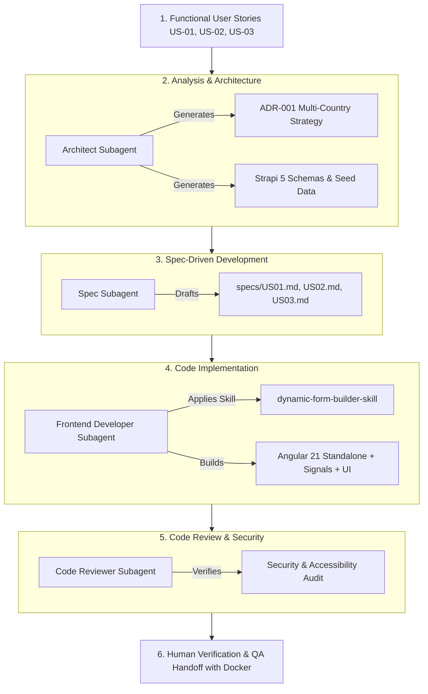

# FLOW.md - Agentic AI Workflow Documentation

This document describes the complete agentic workflow, from receiving functional User Stories to delivering a QA-ready software increment.

---

## 1. Workflow Diagram (Mermaid Diagram)

---

## 2. Step-by-Step Workflow Table

| Step | Description | AI Used? | AI, Agent, Subagent, or Skill Used | Deliverable / Output Produced | Human in the Loop (HITL) |
| :---: | :--- | :---: | :--- | :--- | :--- |
| **1** | **Setup & Context Initialization:** Configuration of global system rules and agent structures. | **Yes** | Primary AI Agent + `AGENTS.md` | `AGENTS.md` file with Angular 21, Signals, and Strapi conventions. | Review and approval of project global guidelines. |
| **2** | **Multi-Country Architecture:** Evaluation of alternatives for Colombia & Chile and Strapi model definitions. | **Yes** | Subagent: `architect-agent` | `ADRs/ADR-001-multi-country-content-strategy.md` and `seed-data.json`. | Approval of single-build dynamic filtering strategy. |
| **3** | **Technical Specification (SDD):** Translating user stories into executable technical specs before coding. | **Yes** | Subagent: `spec-agent` | Technical specs: `specs/US01.md`, `specs/US02.md`, and `specs/US03.md`. | Validation of country regex patterns (Plate/RUT) and business rules. |
| **4** | **Reusable Skill Creation:** Defining the pattern for dynamic form construction from Strapi JSON. | **Yes** | Skill: `dynamic-form-builder-skill` | `skills/dynamic-form-builder.md` file. | Verification of typed form validator structure in Angular. |
| **5** | **Frontend Implementation:** Building Angular 21 Standalone components, Signals state, and differentiators. | **Yes** | Subagent: `frontend-developer-agent` + `dynamic-form-builder-skill` | Step 1, 2, 3 components, Plan Comparator, and PDF/QR Policy in `apps/frontend/`. | UX testing, country switching, and browser navigation checks. |
| **6** | **Audit & Code Review:** Security inspection (no write tokens in browser) and ARIA/Keyboard accessibility. | **Yes** | Subagent: `code-reviewer-agent` | Code audit report and TypeScript strict typing fixes. | Approval of code quality, security, and accessibility standards. |
| **7** | **Testing & Containerization:** Unit tests, E2E test spec, and Docker Compose orchestration. | **Yes** | Primary AI Agent | `wizard-store.service.spec.ts`, `insurance-flow.spec.ts`, and `docker-compose.yml`. | Final execution of `docker compose up` and sign-off for QA handoff. |

---

## 3. Reflexive Questions & Evaluation Answers

### • What would you do differently if a team of 5 developers used this workflow?
1. **CI/CD Integration (GitHub Actions / GitLab CI):** Configure an automated CI pipeline where the `code-reviewer-agent` runs static security and style audits on every Pull Request before allowing merges to `main`.
2. **Centralized Agent & Skill Registry:** Version subagent definitions and skills in a shared internal organization npm package so all 5 developers share identical coding standards.
3. **Strict Spec Branching Workflow:** Require each developer to generate a feature spec in `specs/` using the `spec-agent` before opening a feature development branch.

### • Which part of the workflow did not work as expected and how did you adjust it?
* **Initial Challenge:** Early dynamic form generations triggered TypeScript index signature errors (`TS7053: Element implicitly has an 'any' type`), and policy downloads produced a raw `.txt` file instead of a formatted PDF document.
* **Adjustment Made:** Refactored the `dynamic-form-builder` skill to enforce explicit map types (`Record<string, any>`) and updated the PDF generator to use a native A4 print template (`@page { size: A4 }`) that directly triggers the browser's native *"Save as PDF"* print dialog.

### • At which points did you decide NOT to use AI and why?
1. **Visual UX & Responsiveness Verification:** Testing actual browser look-and-feel, country theme highlights, animations, and responsive breakpoints was performed manually in a real browser.
2. **Business Rule Validation:** Verifying policyholder legal age limits (>= 18 years) and vehicle model age constraints (2005-2026) required human domain confirmation to ensure alignment with Colombian and Chilean insurance regulations.
